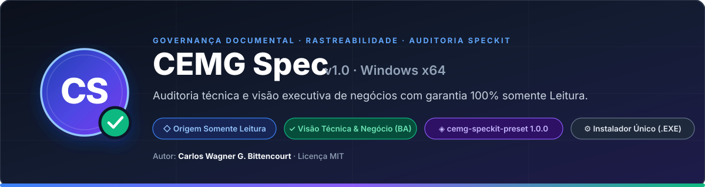
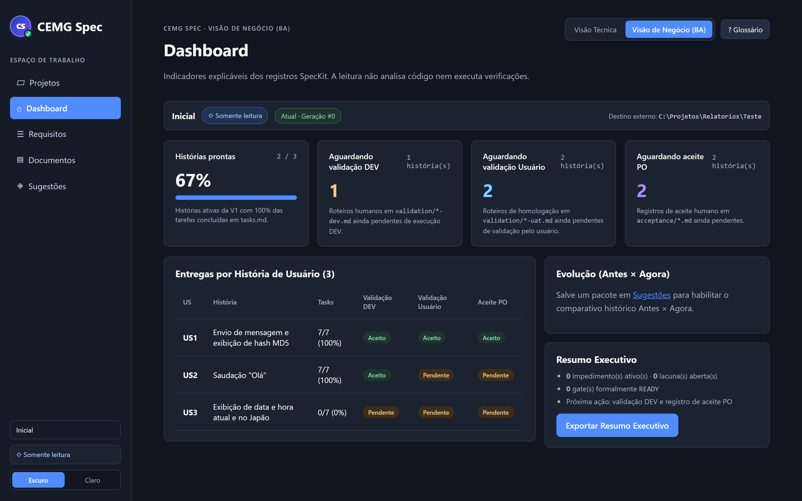
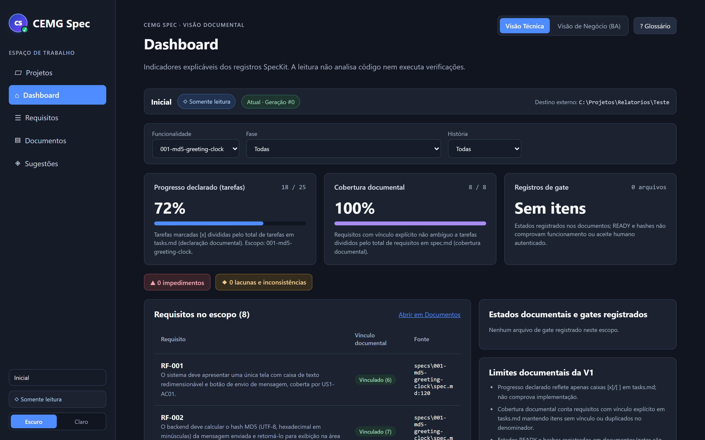
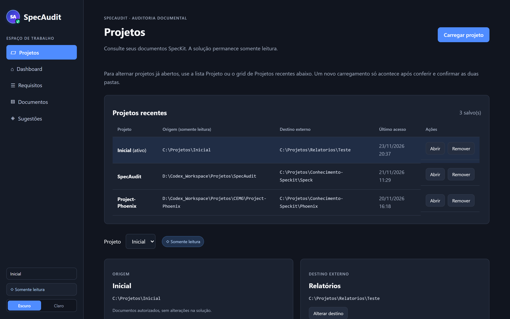
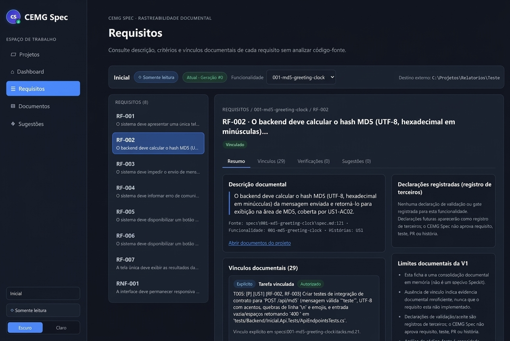
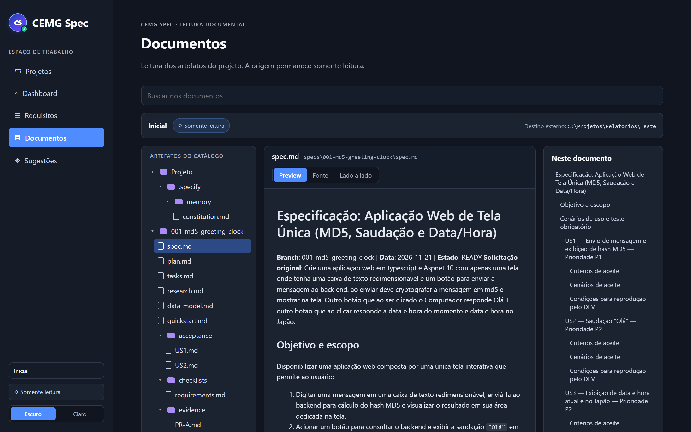
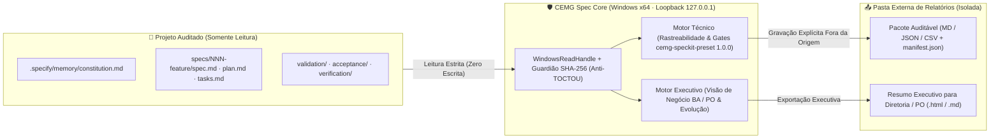

<div align="center">



<br />

[-0078D4?style=for-the-badge&logo=windows&logoColor=white)](installer/CemgSpec-Setup.exe)
[](CemgSpec/CemgSpec.csproj)
[](#visão-geral)
[](#arquitetura-e-fronteira-de-segurança)
[-F59E0B?style=for-the-badge)](LICENSE)

<p align="center">
  <a href="#como-instalar-e-executar-no-windows"><strong>⬇ Baixar Instalador Windows</strong></a> ·
  <a href="#vitrine-visual-da-aplicação"><strong>🖥 Vitrine Visual das Telas</strong></a> ·
  <a href="#arquitetura-e-fronteira-de-segurança"><strong>🛡 Arquitetura &amp; Segurança</strong></a> ·
  <a href="#como-utilizar-o-programa-passo-a-passo"><strong>📖 Guia Passo a Passo</strong></a> ·
  <a href="docs/apresentacao-cemg-spec.pdf"><strong>📊 Apresentação Executiva (PDF)</strong></a> ·
  <a href="#licença-direitos-autorais-e-isenção-de-responsabilidade-mit-license"><strong>⚖ Licença &amp; Termos</strong></a>
</p>

</div>

---

## Visão Geral

O **CEMG Spec** é uma plataforma desktop para **Windows x64** voltada à **auditoria técnica e visão executiva de negócios com garantia 100% somente Leitura**, projetada para validar a conformidade documental, a rastreabilidade ponta a ponta de requisitos (`FR` / `NFR` / `RF` / `RNF`) e a prontidão executiva de projetos conduzidos com **SpecKit (`cemg-speckit-preset 1.0.0`)**.

Diferente de ferramentas que alteram o repositório analisado, o **CEMG Spec** opera sob uma fronteira física **100% Somente Leitura (*Read-Only Origin*)**: nenhuma linha de código ou documento do projeto auditado é jamais modificada.

### Configuração recomendada: CEMG Spec Kit Preset

Para aproveitar a rastreabilidade documental do **CEMG Spec**, recomendamos aplicar o [**CEMG Spec Kit Preset**](https://github.com/cwgbittencourt/cemg-speckit-preset) ao projeto analisado. Ele padroniza requisitos, critérios de aceite, tarefas e evidências de validação, facilitando a conexão entre o que foi pedido e o que foi construído.

Consulte as [instruções de instalação e adoção do preset](https://github.com/cwgbittencourt/cemg-speckit-preset#instalacao). A instalação atualiza os templates e comandos para o trabalho futuro, mas **não adapta automaticamente especificações antigas nem a constituição já preenchida**. Em projetos existentes, revise esses documentos conforme o guia de adoção.

O CEMG Spec consulta os registros disponíveis; aplicar o preset não comprova, por si só, que a implementação atende aos requisitos.

### Dupla Perspectiva de Governança

| Dimensão | Visão Técnica *(Engenharia / QA / Arquitetura)* | Visão de Negócio *(BA / PO / Diretoria)* |
| :--- | :--- | :--- |
| **Foco Principal** | Integridade estrutural dos artefatos SpecKit e cobertura de código/testes | Prontidão de entrega por História de Usuário (`US1..USn`) e homologações humanas |
| **Indicadores (KPIs)** | Requisitos cobertos, Tarefas concluídas, Documentos esperados e Ocorrências abertas | Prontidão da Funcionalidade (%), Prontas para Aceite, Aguardando Usuário e Pendências Críticas |
| **Validações Auditadas** | `constitution.md`, `spec.md`, `plan.md`, `tasks.md` e `verification/*-stage.json` | **Validação DEV** (`USx-dev.md`), **Validação Usuário** (`USx-user.md` / `USx-uat.md`) e **Aceite PO** (`acceptance/USx.md`) |
| **Saída Auditável** | Pacote técnico (`report.md`, `report.json`, `findings.csv`, `indicators.csv`, `manifest.json`) | **Resumo Executivo em Markdown/HTML** com delta de evolução (*Antes × Agora*) |

---

## Vitrine Visual da Aplicação

### 1. Dashboard — Visão de Negócio (Analista de Negócio / PO / Diretoria)
Painel executivo com os 4 cartões de prontidão, matriz de entregas por História de Usuário (`US1..USn`), status de homologação (**Validação DEV**, **Validação Usuário** e **Aceite PO**), tooltips com o caminho exato do arquivo esperado e exportação de Resumo Executivo.

<p align="center">
  
</p>

### 2. Dashboard — Visão Técnica e Ocorrências Documentais
Métricas de conformidade documental, estado formal dos gates (`READY` / `BLOCKED`), filtros em cascata (**Fase $\rightarrow$ História**, **Gravidade** e **Situação**) e deep-link direto para a linha exata do arquivo onde a ocorrência foi detectada.

<p align="center">
  
</p>

### 3. Gestão de Projetos e Grade de Projetos Recentes
Seleção explícita em duas etapas (**Origem Somente Leitura** e **Destino Externo de Relatórios**), com histórico persistente dos últimos projetos auditados para reabertura em 1 clique.

<p align="center">
  
</p>

### 4. Matriz de Rastreabilidade de Requisitos e Leitor Seguro de Documentos
Inspeção detalhada de cada requisito (`FR`/`RF` e `NFR`/`RNF`) com seus vínculos na especificação, plano, tarefas e evidências, integrada ao leitor seguro com modos **Visualização**, **Código-fonte** (numerado linha a linha) e **Dividido**.

<p align="center">
  
  
</p>

---

## Arquitetura e Fronteira de Segurança



- **Proteção Nativa Win32 (`WindowsReadHandle`):** Todos os arquivos da origem são abertos exclusivamente com descritores de leitura (`GENERIC_READ`), bloqueando junções/reparse points maliciosos e validando a identidade do volume/índice e o hash `SHA-256` antes e depois de cada leitura.
- **Isolamento de Rede (`Loopback-Only`):** O servidor local responde exclusivamente em `127.0.0.1:5187` com sessão criptográfica `HttpOnly` / `SameSite=Strict`, recusando qualquer conexão externa da rede local.
- **Impossibilidade de Contaminação da Origem:** O `ExternalReportWriter` verifica por identidade de handle do Windows que a pasta de relatórios nunca coincide nem está contida dentro da pasta do projeto auditado.

---

## Como Instalar e Executar no Windows

### Opção 1 — Instalador Gráfico Único (`CemgSpec-Setup.exe`) *(Recomendado)*

O **CEMG Spec** conta com um instalador gráfico de arquivo único que **não requer privilégios de Administrador** e **não exige instalação prévia do .NET**:

1. Baixe ou execute o instalador publicado em **[`installer/CemgSpec-Setup.exe`](installer/CemgSpec-Setup.exe)** *(também disponível na seção [**Releases `v1.0.0`**](../../releases/tag/v1.0.0) do GitHub)*.
2. Na tela do instalador, mantenha marcadas as opções desejadas:
   - ☑ *Criar atalho com ícone CS na Área de Trabalho e no Menu Iniciar*
   - ☑ *Iniciar o CEMG Spec em segundo plano (ícone CS perto do relógio) e abrir navegador*
3. Clique em **Instalar agora**.
4. O aplicativo será instalado em `%LOCALAPPDATA%\Programs\CemgSpec` e abrirá automaticamente no navegador em `http://127.0.0.1:5187`.

> [!TIP]
> **Execução Invisível em Segundo Plano (Sem Janela Preta de Prompt):**  
> Ao iniciar o **CEMG Spec** pelo atalho da Área de Trabalho ou Menu Iniciar, o programa roda silenciosamente em segundo plano e posiciona o ícone **`CS ✓` na bandeja do sistema (perto do relógio do Windows)**.  
> Clique com o **botão direito** no ícone **`CS ✓`** perto do relógio para **Abrir o CEMG Spec no navegador** ou **Encerrar o CEMG Spec**.

#### Como Desinstalar no Windows
Você pode desinstalar o **CEMG Spec** a qualquer momento por qualquer um dos 3 caminhos abaixo (seus projetos e relatórios salvos permanecem intactos):
1. **Configurações do Windows:** *Configurações → Aplicativos → Aplicativos instalados → CEMG Spec → Desinstalar*.
2. **Menu Iniciar:** *Menu Iniciar → Todos os aplicativos → CEMG Spec → Desinstalar CEMG Spec*.
3. **Pelo próprio `CemgSpec-Setup.exe`:** Abra o instalador e clique no botão vermelho **Desinstalar versão atual**.

---

### Opção 2 — Compilar o Instalador ou Executar via Código-Fonte (.NET 10 SDK)

Em uma estação de desenvolvimento Windows x64 com o **.NET 10 SDK**:

```powershell
# Executar diretamente em modo desenvolvimento (abrindo o navegador):
dotnet run --project .\CemgSpec\CemgSpec.csproj -- --open-browser

# Ou regerar o instalador único (installer/dist/CemgSpec-Setup.exe):
powershell -ExecutionPolicy Bypass -File .\installer\Build-Installer.ps1
```

---

## Como Utilizar o Programa (Passo a Passo)

1. **Carregar um Projeto (`Projetos`):**
   - Clique em **Carregar projeto** $\rightarrow$ **1. Escolher projeto** (selecione a pasta-raiz da solução que contém `.specify` e `specs`) $\rightarrow$ **2. Escolher destino** (selecione uma pasta **fora** do projeto para salvar relatórios) $\rightarrow$ **Confirmar carregamento**.
2. **Acompanhar Indicadores Executivos e Técnicos (`Dashboard`):**
   - Alterne no topo entre **Visão Técnica** e **Visão de Negócio (BA)**.
   - Na **Visão de Negócio (BA)**, passe o mouse sobre os selos de **Validação DEV**, **Validação Usuário** e **Aceite PO** para ver o caminho exato do arquivo esperado, clique em **`? Glossário`** para consultar as palavras-chave de aprovação (`Decisão: ACEITO`, `Resultado: APROVADO`) ou clique em **`Exportar Resumo Executivo`**.
3. **Auditar Requisitos (`Requisitos`):**
   - Selecione qualquer requisito (`FR-001`, `RF-001`, `NFR-001`, `RNF-001`) para inspecionar sua cobertura documental na aba **Resumo** e navegar pelos arquivos citados na aba **Vínculos**.
4. **Inspecionar Artefatos (`Documentos`):**
   - Navegue pela árvore documental do projeto com visualização Markdown rica, código-fonte numerado linha a linha ou modo dividido lado a lado.
5. **Registrar Pareceres e Salvar Relatório (`Sugestões`):**
   - Registre decisões humanas (*Aceita*, *Rejeitada*, *Adiada*, *Resolvida*) com justificativa e exporte o pacote completo com manifesto criptográfico `SHA-256`.

---

## Documentação e Apresentação Executiva

- 📘 **[Guia Completo de Uso das Telas (Markdown)](docs/GUIA_DE_USO_TELAS.md)**
- 📊 **[Apresentação Executiva para Diretoria / Board (PDF Paisagem A4)](docs/apresentacao-cemg-spec.pdf)**
- 🌐 **[Apresentação Executiva Interativa (HTML Retina 2x)](docs/apresentacao-cemg-spec.html)**

---

## Licença, Direitos Autorais e Isenção de Responsabilidade ([MIT License](LICENSE))

> [!IMPORTANT]
> **Licença MIT — Copyright (c) 2026 Carlos Wagner G. Bittencourt**
>
> 1. **Preservação Obrigatória dos Direitos Autorais:** Todos os direitos autorais e de autoria original deste software (**CEMG Spec**) pertencem a **Carlos Wagner G. Bittencourt**. Sob os termos da [Licença MIT](LICENSE), é **condição obrigatória** que o aviso de direitos autorais (`Copyright (c) 2026 Carlos Wagner G. Bittencourt`) e o aviso de permissão sejam mantidos em todas as cópias ou partes substanciais do software.
> 2. **Permissão de Uso ("Como Está" / *As Is*):** O software é fornecido **"COMO ESTÁ" (*"AS IS"*)**, sem garantia de qualquer tipo, expressa ou implícita, incluindo, mas não se limitando às garantias de comercialização, adequação a uma finalidade específica e não violação.
> 3. **Isenção Total de Responsabilidade:** Em nenhuma hipótese o autor ou detentor dos direitos autorais será responsável por qualquer reivindicação, danos diretos, indiretos, incidentais ou qualquer outra responsabilidade (incluindo, sem limitação, danos ao computador, perda de dados, falhas de hardware/software ou interrupção operacional) decorrentes da instalação, uso ou incapacidade de uso deste programa. O risco integral quanto à utilização do software cabe exclusivamente ao usuário.
