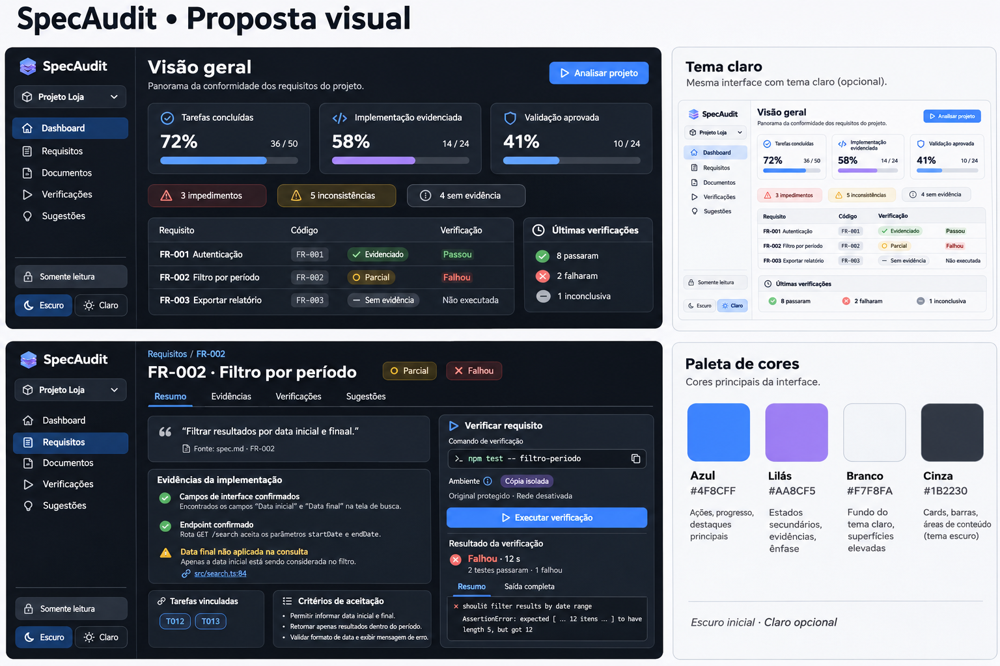
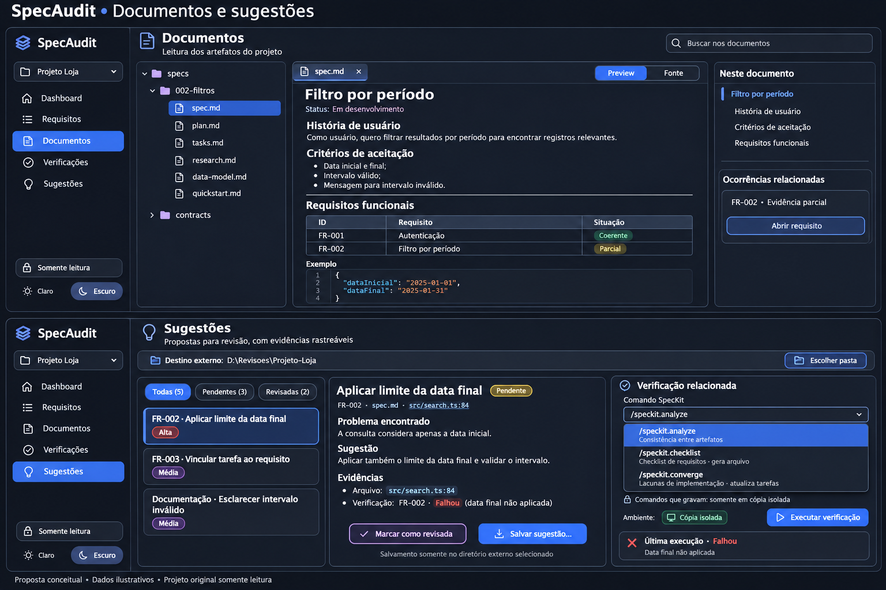
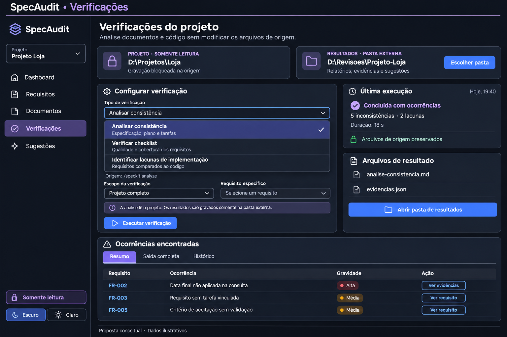

# Referência visual aprovada — CemgSpec V1

**Registrada**: 2026-11-16 | **Preset**: cemg-speckit 3.0.0 | **Constituição**: 3.0.0.
Os três mockups originais aprovados na conversa foram copiados sem edição. São agora referência versionável para implementar a aparência, e não novas funcionalidades. A especificação/contratos vigentes prevalecem sobre qualquer texto, número, comando ou comportamento histórico desenhado nas imagens. Não reproduzir os comportamentos descartados abaixo. Nenhuma implementação foi realizada para registrar estas referências.

## Catálogo

| Arquivo | Referência de aparência | Tarefas de interface |
|---|---|---|
| [Dashboard e ficha](dashboard-requisito.png) | Sidebar, cards/indicadores, tabela, ficha com painéis, abas, ícones, tema claro e paleta | T031, T038, T044 |
| [Documentos e sugestões](documentos-sugestoes.png) | Árvore de arquivos, busca, preview Markdown, contexto à direita, lista/detalhe de sugestões e botão Salvar | T024, T084 |
| [Verificações e pasta externa](verificacoes-pasta-externa.png) | Origem/destino em cards, combo, configuração/resultados e tabela de ocorrências | T058, T067, T070 |

Originais gerados em 15/11/2026, às 22:13, 22:17 e 22:21 (America/Sao_Paulo), neste chat. manifest.json registra nomes originais, tamanhos e SHA256 para conferir cópias; não depende da pasta pessoal do autor. As imagens são ilustrações por IA com dados fictícios e eventuais erros de texto/alinhamento, não capturas de software implementado.

## Preservar na implementação

- Identidade visual e composição aprovadas: azul/lilás, fundos escuros, cards delimitados, textos claros/cinzas, sidebar persistente, ícones discretos, hierarquia de títulos, espaçamento e densidade próximos das imagens.
- Base de paleta da proposta: azul #4F8CFF, lilás #AA8CF5, branco #F7F8FA, superfícies cinza #1B2230 e fundo escuro #11151F. Tema escuro inicial e tema claro opcional coerente; ajustar contraste/legibilidade sem descaracterizar.
- Navegação Dashboard, Requisitos, Documentos, Verificações e Sugestões; projeto selecionado, origem somente leitura e destino externo identificáveis. Tema preserva seleção/conteúdo.
- Preview Markdown com aparência familiar do VS Code, árvore e contexto, nos modos Preview/Fonte/Lado a lado já especificados; nada editável. Mermaid e segurança continuam regidos pela spec.
- Sugestões com lista/detalhe, fontes documentais, gravidade textual/ícone, decisões humanas e ação Salvar. Detalhes de verificação podem ser mostrados como contexto, sem criar uma terceira localização independente da seleção por projeto.
- Conservar linguagem visual, não exigir cópia pixel a pixel, textos fictícios incorretos ou problemas de acessibilidade das imagens. Responsividade não deve ocultar a informação de proteção/escopo.

## Correções obrigatórias de comportamento na V1

| Conteúdo histórico nas imagens | Implementar na V1 |
|---|---|
| Implementação evidenciada, evidências em src/search.ts e data final não aplicada no código | Progresso declarado, cobertura e inconsistências documentais. Não abrir/analisar código, avaliar implementação ou indicar teste executado pelo CemgSpec |
| Validação aprovada/Passou/Falhou sugerindo teste funcional | Estados/declarações registrados com fonte e limites, separados do resultado atual do gate e dos erros de execução; sem aceite humano autenticado por IA/hash |
| npm test, comando livre ou cópia isolada | Remover. Nenhum build/teste/restore da solução ou cópia isolada; origem somente leitura durante todo o fluxo |
| Combo analyze/checklist/converge ou três opções | Exatamente speckit-analyze — Consistência documental e check_gate — Validar gates; sem texto livre/encadeamento; mesma seleção por projeto em Verificações/ficha |
| Resultado ilustrado como salvo automaticamente, lista de arquivos/Abrir pasta antes da ação | Resultado oficial em memória até clicar Salvar; listar/abrir arquivos apenas se houver registro efetivamente salvo em destino externo |
| Projeto completo/requisito específico sem alcance claro | Informar funcionalidade e foco documental; check_gate seleciona etapa/registro/revisão esperada e não vira gate individual do requisito |
| Painel de agente implícito em qualquer verificação | Gate local não exige IA/rede/autenticação; agente somente para analyze; indisponibilidade/proteção não validada deixa Executar desabilitado |
| Botão Executar sem prova indicada | Cada integração só é habilitada depois da prova Passed prevista em tasks.md; imagens não são evidência de proteção operacional |

Somente leitura, ausência de código na V1, Save explícito e proteção antes da habilitação não são opcionais para aproximar o layout. As imagens não autorizam correções, gravação temporária/restauração, uso de segredos, execução de hooks/scripts/plugins ou instalação/elevação.

## Como validar o visual nas tarefas

T021/T029/T036/T043/T053/T079 devem preparar cenários comparativos dos componentes de interface. Nas execuções e reviews de US2/3/4/5/6/8 e na regressão T089, abrir as imagens locais deste diretório junto da versão real do aplicativo, registrar capturas em ambos os temas e comparar hierarquia, paleta, sidebar/cards/tabelas/painéis/modos relevantes. Conferir também as substituições obrigatórias da tabela acima: imagem bonita não aprova comportamento antigo ou proteção não comprovada.

Evidências futuras devem registrar imagem de referência, versão do app, tema/tela, diferença intencional e justificativa, sem segredos. Mockup de IA é referência de aparência, não teste executado ou aceite funcional. Não marcar tasks concluídas por apenas consultar as imagens.

## Prévias

### Dashboard e ficha do requisito

### Documentos e sugestões

### Verificações e pasta externa

